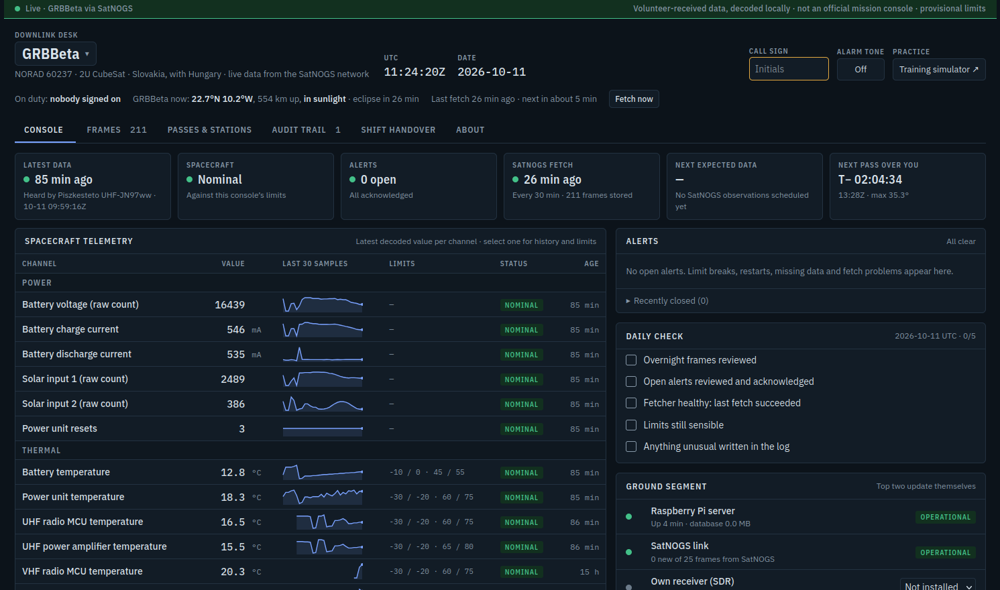

# Downlink Desk

**A lightweight mission-operations console for small satellite teams. Runs on a $15 Raspberry Pi Zero 2 W.**

Downlink Desk pulls real telemetry for a satellite from the [SatNOGS](https://satnogs.org) volunteer ground-station network, decodes it on the Pi, and gives a small team an operations console around it:

- **Health telemetry** checked against caution and alarm limits, with seven-day history per channel
- **Expected vs received:** reads the public SatNOGS Network schedule, so it knows which stations will listen and when, scores every observation as heard or empty, and shows when the next data should arrive
- **Silent-satellite alarm** when several scheduled observations in a row deliver nothing, plus a backstop alert when frames simply stop, and **fetch-health alerts** when the Pi can't reach SatNOGS
- **Orbit context:** every frame is tagged sunlit or eclipse with the satellite's position, charts shade eclipses, and the console shows where the satellite is right now
- **Learned limits:** one click proposes caution and alarm limits from the satellite's own history, for the operator to review and sign
- **Phone alerts** through the free ntfy app: alarms, restarts, silence and fetch failures
- **Several satellites at once:** a picker in the header switches between tracked satellites, each with its own history, alerts, limits and schedule; a catalog browser with bios adds more
- **Restart detection** from the spacecraft's own boot counters
- **Acknowledge and shelve** alerts, with a reason, under your call sign
- **A signed audit trail**: every operator action is hash-chained on the Pi, so edits or deletions show up on verify
- **Daily check, shift handover report, equipment status, pass predictions** over your own location
- **A training simulator** with fault injection for practice and demos

> ⚠️ **Not flight software.** Downlink Desk is not affiliated with any satellite team, cannot command a spacecraft, and ships with provisional limits chosen for this console rather than the mission's own. Don't use it to make decisions about real hardware.


*Screenshot from the test suite, using synthetic frames in GRBBeta's format.*

**Try the training simulator in your browser:** enable GitHub Pages for the `docs/` folder and it's served at `https://archer7778.github.io/downlink-desk/`.

## How it works

```
volunteer SatNOGS stations ──► SatNOGS DB ──► Pi: fetch job (every 30 min) ──► SQLite ──► web console
                                              decodes with satnogs-decoders              on your network
```

- `downlink_desk/fetch.py` asks the SatNOGS DB API for new frames, politely: at least 11 s between requests, honours `Retry-After`, holds satellites flagged as frequency violators to one request a day.
- Frames are decoded locally with the community [satnogs-decoders](https://pypi.org/project/satnogs-decoders/) package and mapped to channels by a small JSON file.
- `downlink_desk/server.py` is a standard-library web server that serves the console and a JSON API, and signs audit-log entries.
- Scheduled observations come from the public SatNOGS Network API every 3 hours, one request.
- Sunlight and position come from the latest orbit data (SGP4 plus a cylindrical Earth-shadow model).
- Alerts are worked out in the browser from the stored telemetry, so every viewer sees the same thing. Phone alerts are checked by the fetch job on the Pi.

The first satellite is **GRBBeta** (NORAD 60237), a 2U CubeSat from the Technical University of Košice testing a gamma-ray detector. Track more from the **satellite picker** in the console header: it lists every satellite in orbit that SatNOGS can decode, with hand-written bios for a featured few (CroCube, Foresail-1p, CatSat, CubeBel-2, Sharjahsat-1, UWE-4). Satellites without a curated channels file get automatic channels: every numeric field the decoder produces, in raw units.

## Install on a Raspberry Pi

You need Raspberry Pi OS Lite (64-bit), an internet connection, and a free SatNOGS DB account for the API key. Full walkthrough: [docs/SETUP.md](docs/SETUP.md).

```bash
sudo apt install -y git
git clone https://github.com/archer7778/downlink-desk.git downlink-desk
cd downlink-desk
./deploy/install.sh
```

The installer asks for your location and API key, installs two background services, and prints the console address (for example `http://groundpi.local:8080`).

## Develop and test

```bash
python3 -m venv .venv && .venv/bin/pip install -r requirements.txt
.venv/bin/python tests/test_pipeline.py           # fetch → decode → store → verify, against a mock SatNOGS
.venv/bin/python tests/mock_satnogs.py --port 8765 # offline demo data source
```

## Limitations

- Data arrives minutes to hours after a pass, only when a volunteer station heard the satellite and uploaded it.
- Limits and some unit conversions (millivolts, kelvin) are inferred from decoder field names. Check them against the mission's documentation.
- The audit trail is tamper-evident, not tamper-proof: someone with access to the Pi's files could rebuild the chain.
- No user accounts. Run it on your home network or a private network such as Tailscale, and set `write_passcode` if others can reach it.

## Credits

- Telemetry: the [SatNOGS](https://satnogs.org) network, run by the [Libre Space Foundation](https://libre.space) and volunteer station operators. SatNOGS data is licensed [CC BY-SA 4.0](https://creativecommons.org/licenses/by-sa/4.0/).
- Decoding: [satnogs-decoders](https://pypi.org/project/satnogs-decoders/). Orbits: [python-sgp4](https://pypi.org/project/sgp4/).
- GRBBeta is operated by its own team: <https://grbbeta.tuke.sk/>.
- Built with help from Claude (Anthropic). Commits it made are marked as co-authored.

## License

MIT. See [LICENSE](LICENSE).
